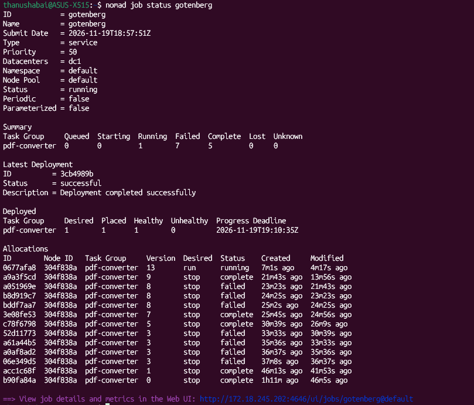
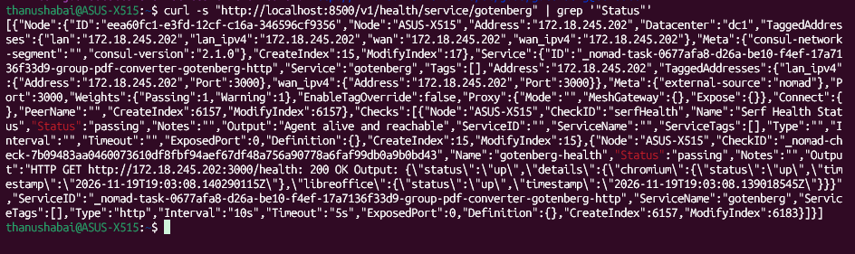
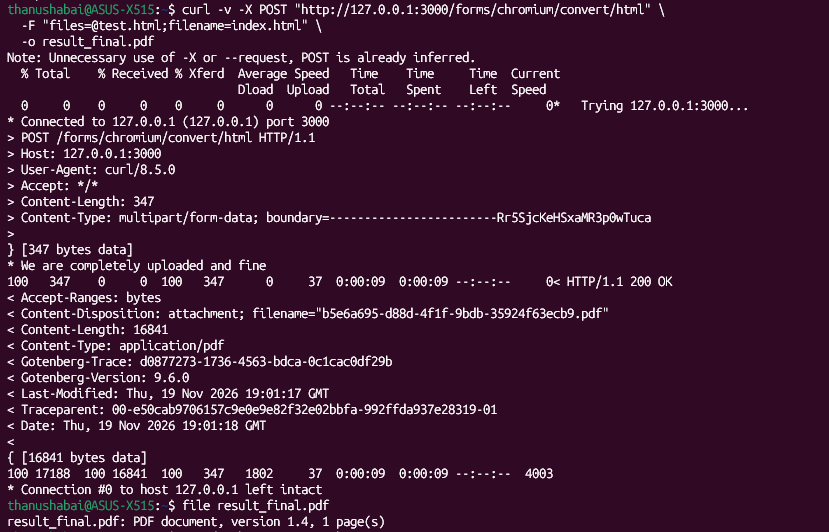
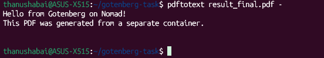

# Gotenberg Document-to-PDF Service on Nomad & Consul

## 1. Overview & Research

**What Gotenberg Does:**
Gotenberg is a stateless REST API that converts web documents (HTML, Markdown, URLs) and office formats (DOCX, XLSX, PPTX) into PDF files. It uses headless Chromium for web-based conversions and LibreOffice for office documents.

**Runtime Requirements:**
- **Port:** Listens on TCP port `3000`.
- **Health Endpoint:** Exposes an unauthenticated `GET /health` endpoint.
- **Resources:** Requires at least 512 MiB of memory to boot, and a minimum of 0.2 CPU. Chromium requires sufficient shared memory (`/dev/shm`) to function without crashing.

**Pinned Image Version:** `gotenberg/gotenberg:9.6.0`
- **Reasoning:** Pinned to an explicit SemVer tag (not `latest`) to guarantee deterministic deployments, prevent unexpected breaking changes, and ensure compatibility with the Chromium/LibreOffice memory-management controls.
- **Official Docs Citation:** [Gotenberg Installation Docs](https://gotenberg.dev/docs/getting-started/installation)

## 2. Nomad Job Specification

*Note: The Docker driver was configured with `network_mode = "host"` and `shm_size = 512`. This was critical because Chromium requires shared memory, and Nomad's default Docker bridge networking was silently blocking Gotenberg's `tini` entrypoint from binding to the port.*

```hcl
job "gotenberg" {
  datacenters = ["dc1"]
  type        = "service"

  group "pdf-converter" {
    count          = 1
    shutdown_delay = "5s"

    network {
      mode = "host"
      port "http" {
        static = 3000
      }
    }

    service {
      name     = "gotenberg"
      port     = "http"
      provider = "consul"

      check {
        name     = "gotenberg-health"
        type     = "http"
        path     = "/health"
        interval = "10s"
        timeout  = "5s"
      }
    }

    task "gotenberg" {
      driver = "docker"

      config {
        image        = "gotenberg/gotenberg:9.6.0"
        ports        = ["http"]
        shm_size     = 512
        network_mode = "host"
      }

      resources {
        cpu    = 1000
        memory = 1024
      }
    }
  }
}
```

## 3. Resource Limits & Measured Memory Usage

- **CPU (1000 MHz):** Allocated to handle short-lived CPU bursts when headless Chromium spawns worker processes to parse and render documents.
- **Memory (1024 MB):** Allocated because Chromium spawns multi-process rendering engines per request. 1024 MB prevents Linux cgroup Out-Of-Memory (OOM) kills during concurrent conversions while leaving headroom on the host.
- **Measured Memory (via `docker stats`):**
  - Idle baseline: ~10.4 MiB / 1 GiB (1.01%)
  - *(Note: Active conversion memory spikes temporarily but stays well within the 1024 MB limit).*

## 4. Consul Verification & Live Conversion Proof

The service was deployed successfully and registered in Consul.

**Nomad Deployment:**



**Consul Health Check:**



*Verified via Consul API: Service `gotenberg` is registered with a passing health check.*

**Real Conversion Request:**



*Request sent to `http://127.0.0.1:3000/forms/chromium/convert/html` using a multipart form payload. Returned `HTTP/1.1 200 OK`.*

**Returned PDF Verification:**



*The curl command successfully returned a PDF file. The content matches the input HTML exactly.*

## 5. Candidate Calling Services

- **Current Environment Findings:** No other internal company application services were found in this standalone Nomad/Consul environment.
- **Expected Production Consumers:** In a production microservice architecture, Gotenberg would be called over Consul service discovery (`gotenberg.service.consul`) by backend services responsible for billing/invoice generation, automated compliance reports, customer contract exports, and document preview pipelines. This offloads heavy Chromium/LibreOffice dependencies from core business microservices.

## 6. License & Internal Use Compliance

- **License:** MIT License (per the Gotenberg Official Website and GitHub License).
- **What It Allows for Internal Use:** The MIT License is a permissive open-source license allowing unrestricted internal commercial use, self-hosting, modification, and internal distribution at zero licensing cost. It has no copyleft obligations, requiring only that the original copyright notice is retained if the software is redistributed.
